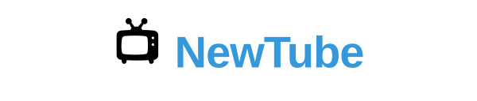

<p align="center">
  
</p>

<p align="center">
  
  
  <a href="https://rafaelfachinelli.com">
    
  </a>
  
</p>

<p align="center">
  <a href="#information_source-about">About</a> •
  <a href="#memo-tasks">Tasks</a> •
  <a href="#arrow_forward-run">Run</a> •
  <a href="#hammer_and_wrench-technologies">Technologies</a> •
  <a href="#boy-author">Author</a> •
  <a href="#balance_scale-license">License</a>
</p>

---

## :information_source: About

📺 A YouTube clone in progress, with the Next.js App Router and shadcn/ui. So far it has the home layout: a navbar with the logo, search input and sign-in button, and a collapsible sidebar with the main and personal sections. The code is organized by feature modules (`src/modules/<feature>/ui`).

Started in 2025.

---

## :memo: Tasks

<div align="center">
<details>
<summary>Click to view</summary>

|State|Task|
|:---:|:---|
|:heavy_check_mark:|Next.js project with Tailwind CSS and shadcn/ui|
|:heavy_check_mark:|Home layout|
|:heavy_check_mark:|Navbar with search input and auth button|
|:heavy_check_mark:|Sidebar with main and personal sections|
|:x:|Authentication|
|:x:|Video upload and playback|
|:x:|Video feed|

</details>
</div>

---

## :arrow_forward: Run

You need [Node.js](https://nodejs.org/). In the project folder:

```bash
# Install dependencies
npm install

# Start the development server
npm run dev
```

> The app opens at <http://localhost:3000>.

---

## :hammer_and_wrench: Technologies

<div align="center">

|Web|
|:---:|
|[Next.js](https://nextjs.org/)|
|[React](https://react.dev/)|
|[TypeScript](https://www.typescriptlang.org/)|
|[Tailwind CSS](https://tailwindcss.com/)|
|[shadcn/ui](https://ui.shadcn.com/)|
|[Radix UI](https://www.radix-ui.com/)|

</div>

---

## :boy: Author

<div align="center">

<a href="https://rafaelfachinelli.com">
  
  <br/>
  <sub><b>Rafael Fachinelli</b></sub>
</a>

Tech Lead and software engineer. Get in touch!

[](https://rafaelfachinelli.com)
[](https://www.linkedin.com/in/rafaelfachinelli/)
[](https://github.com/rafaelfachinelli)
[](mailto:rafael.l.a.fachinelli@gmail.com)

</div>

---

## :balance_scale: License

This project is under the [MIT license](./LICENSE).
